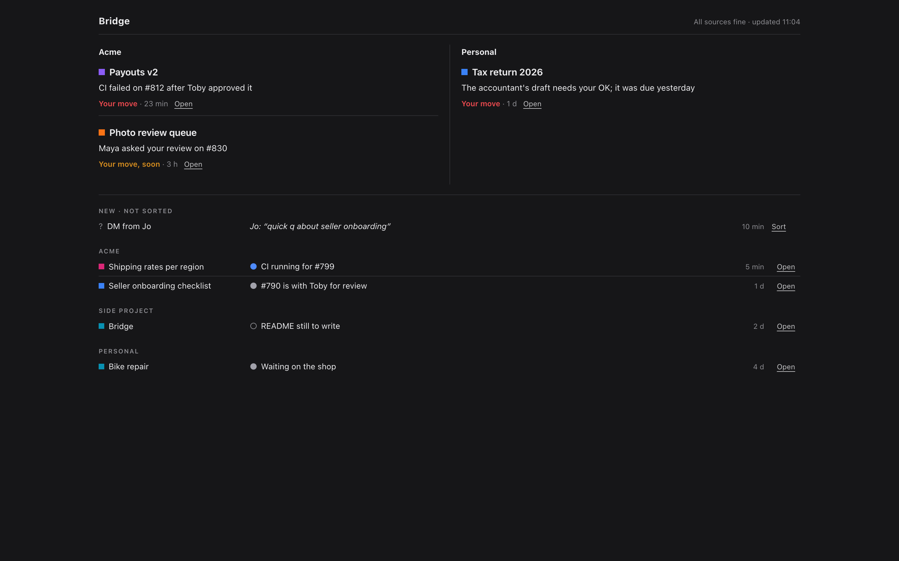

# bridge

One local page for everything I need to do, answer or keep an eye on, across Slack, GitHub, Linear and Notion GTD. It groups things into **topics**, works out **who has the ball** and **what's next**, and gives each topic its own browser tab.

Design: [`docs/superpowers/specs/2026-11-20-bridge-design.md`](../../docs/superpowers/specs/2026-11-20-bridge-design.md) · Plan: [`docs/superpowers/plans/2026-11-20-bridge-plan.md`](../../docs/superpowers/plans/2026-11-20-bridge-plan.md)



## Status

Phase 2 of 6: GitHub and Linear are live. Take the helm opens Claude in a PR's clone. Slack, Notion GTD and the officer come next.

## Run

Needs Node 22.18 or newer (`nvm use` picks it up from `.nvmrc`).

```bash
npm install          # only typescript and @types/node, for type checks
npm start            # your GitHub (gh) and Linear, on http://127.0.0.1:7766/
npm run demo         # made-up data on a fixed clock, opens http://127.0.0.1:7767/
npm test
npm run typecheck
node scripts/screenshot.ts   # regenerate docs/*.png
```

`--record` saves every real response to `$BRIDGE_HOME/recordings/`; `BRIDGE_REPLAY=<that folder> npm start` plays them back without the network.

State lives in `$BRIDGE_HOME` (default `~/.claude/bridge/`): `config.json`, `decisions.jsonl` (append-only: merges, moves, closes, snoozes, seen…). The demo writes its own `decisions.demo.jsonl`. Tokens come from env only (`BRIDGE_SLACK_TOKEN`, `BRIDGE_LINEAR_TOKEN`, `BRIDGE_NOTION_TOKEN`), or from `$BRIDGE_HOME/.env` (chmod 600), never from `config.json` or the repo.

## How it fits together

```
sources (phase 2+) → store → topics (+ decisions) → urgency → view → server → web/
```

| File | Does |
|---|---|
| `src/types.ts` | The words from the spec |
| `src/config.ts` | Defaults, validation, tokens from env |
| `src/clock.ts` | Working-hours time (pure) |
| `src/decisions.ts` | Append and replay `decisions.jsonl`; bad lines skipped and reported |
| `src/topics.ts` | Items + decisions → topics, rolled up (pure) |
| `src/urgency.ts` | Red / yellow, hot topics (pure) |
| `src/briefing.ts` | First, rule-based briefing (pure) |
| `src/view.ts` | What each page shows, as JSON (pure) |
| `src/rules/github.ts`, `src/rules/linear.ts` | Who has the ball per PR / story (pure) |
| `src/sources/github.ts`, `src/sources/linear.ts` | gh searches + views; Linear GraphQL |
| `src/poll.ts` | Each source on its interval, backoff, health |
| `src/repos.ts` | Repo → local clone; the Take the helm link |
| `src/record.ts` | `--record` and `BRIDGE_REPLAY` |
| `src/app.ts`, `src/server.ts` | State, HTTP + SSE, `POST /decide` |
| `src/demo.ts`, `demo/demo.json` | Demo mode |
| `web/` | Plain JS and CSS; dark and calm |

Every fixture and the demo data are made up: this repo is public.

## Slack app (phase 3)

Bridge reads Slack as you, read-only, with a user token from an **internal** app (not distributed: internal apps keep Slack's normal rate limits). At [api.slack.com/apps](https://api.slack.com/apps): **Create New App → From an app manifest**, pick the workspace, paste:

```yaml
display_information:
  name: bridge
  description: Read-only. Shows me, on my own laptop, what in Slack waits on me.
oauth_config:
  scopes:
    user:
      - search:read
      - channels:history
      - groups:history
      - im:history
      - mpim:history
      - channels:read
      - groups:read
      - im:read
      - mpim:read
      - users:read
      - users:read.email
settings:
  org_deploy_enabled: false
  socket_mode_enabled: false
  token_rotation_enabled: false
```

Then **Install to Workspace** (an admin may have to approve it), copy the **User OAuth Token** (`xoxp-…`) and add `BRIDGE_SLACK_TOKEN=xoxp-…` to `~/.claude/bridge/.env`.
